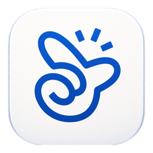
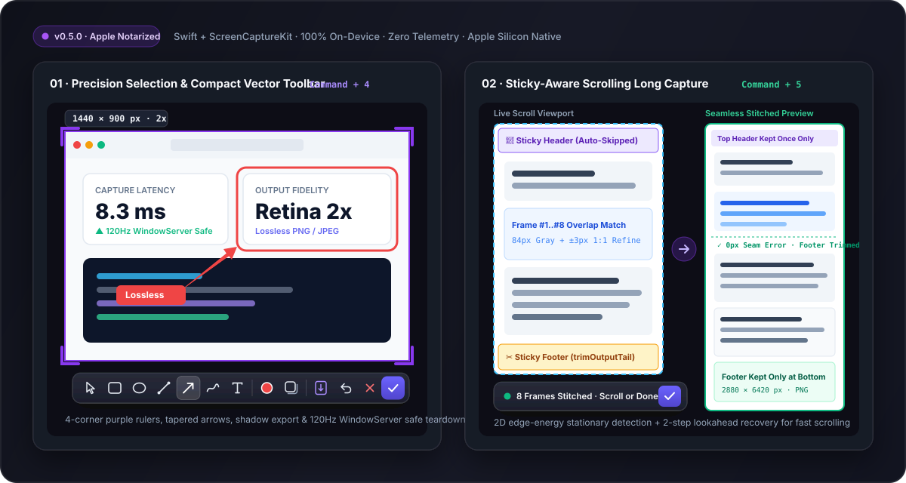
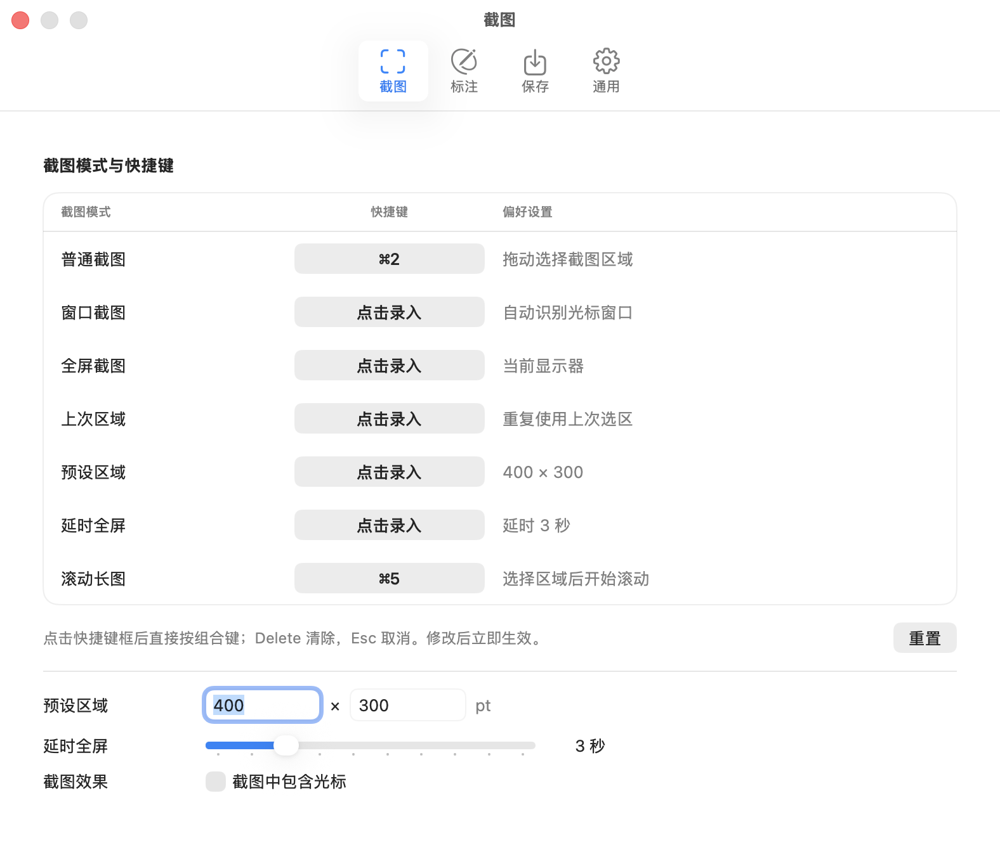

<p align="center">
  
</p>

<h1 align="center">Screen Capture for macOS</h1>

<p align="center">
  <strong>Native, private-by-design screenshot &amp; scrolling long-capture utility for Apple Silicon.</strong><br>
  Built with pure Swift, AppKit &amp; ScreenCaptureKit — 100% on-device, zero ads, zero paywalls, Apple Notarized.
</p>

<p align="center">
  <a href="https://github.com/nasadunadu/screen-capture-macos/releases/latest"></a>
  <a href="https://github.com/nasadunadu/screen-capture-macos/releases/latest"></a>
  <a href="https://github.com/nasadunadu/screen-capture-macos/actions/workflows/ci.yml"></a>
  
  
  <a href="LICENSE"></a>
</p>

<p align="center">
  <a href="https://github.com/nasadunadu/screen-capture-macos/releases/latest/download/ScreenCapture-0.5.0-macos-arm64.dmg"><strong>⬇️ Download DMG (v0.5.0 · Apple Silicon)</strong></a>
  &nbsp;·&nbsp;
  <a href="#install"><strong>🍺 Install via Homebrew</strong></a>
  &nbsp;·&nbsp;
  <a href="README.zh-CN.md"><strong>简体中文文档</strong></a>
  &nbsp;·&nbsp;
  <a href="docs/PRIVACY.md">Privacy</a>
  &nbsp;·&nbsp;
  <a href="CHANGELOG.md">Changelog</a>
</p>

<p align="center">
  
</p>

> 💡 **If Screen Capture saves you from bloated screenshot subscriptions or scrolling-stitch failures, please click ⭐ Star at the top-right to help more Mac users discover it!**

---

## Why Screen Capture?

Many macOS screenshot utilities start simple and gradually turn into bloated subscription suites with cloud accounts, intrusive background daemons, or brittle scrolling capture that stalls whenever a webpage has a sticky header or footer.

**Screen Capture** focuses relentlessly on the **two everyday jobs you actually need**:
1. **Instant Retina Screenshots & Inline Annotation** (`Command-4`) — Select, adjust with 4-corner purple rulers, annotate with precision vector tools, and copy/save lossless PNGs in milliseconds.
2. **Rock-Solid Scrolling Long Capture** (`Command-5`) — Live split-screen preview with automatic sticky header/footer deduplication, `1:1` native-pixel vertical seam refinement, and fast-scroll lookahead recovery.

### How It Compares

| Dimension | **Screen Capture (`v0.5.0`)** | macOS Built-in (`Cmd+Shift+4`) | Freemium Tools (`iShot / Xnip`) | Commercial Tools (`CleanShot X / Shottr`) |
| :--- | :--- | :--- | :--- | :--- |
| **Price & License** | **100% Free & Open Source (`Apache-2.0`)** | Free (System Built-in) | Closed-source Freemium / VIP Paywalls | Paid License (\$12–\$29+) / Closed-source |
| **Scrolling Long Capture** | **Yes — Sticky Header/Footer Auto-Trim + `1:1` Pixel Refine** | ❌ Not supported | ⚠️ Often stalls or duplicates sticky footers / watermarked | ✅ Supported |
| **Inline Vector Toolbar** | **Compact `31×31pt` AI-Era Glassmorphic Vector Strip** | Separate slow Markup preview window | Heavy multi-row legacy toolbar | Modern floating toolbar |
| **`WindowServer` 120Hz Stability** | **Process-level `SCContentFilter` + Deferred Panel Retire** | Native | Legacy window filters prone to macOS 26/27 layer crashes | Varies |
| **Privacy & Network Boundary** | **Zero Network Access · 100% Local RAM** | Local | Often bundles analytics / cloud login | Optional cloud upload |
| **Apple Notarization** | **Developer ID Signed & Stapled** | System | App Store / Direct | Direct |

---

## Install

### Option 1: Homebrew Cask (Recommended for Developers)

```sh
brew tap nasadunadu/tap https://github.com/nasadunadu/screen-capture-macos.git
brew install --cask screencapture
```

### Option 2: Direct DMG Download

1. Download **[ScreenCapture-0.5.0-macos-arm64.dmg](https://github.com/nasadunadu/screen-capture-macos/releases/latest/download/ScreenCapture-0.5.0-macos-arm64.dmg)** (or the fallback `.zip` from [GitHub Releases](https://github.com/nasadunadu/screen-capture-macos/releases/latest)).
2. Open the DMG and drag **ScreenCapture** into **Applications**.
3. Launch **ScreenCapture** — it is signed with an Apple Developer ID and notarized by Apple, so Gatekeeper opens it cleanly without terminal workarounds.

---

## Key Highlights in `v0.5.0`

- **WindowServer Crash Hardening (macOS 26/27)**: Replaces per-window `SCContentFilter` arrays with process-level `excludingApplications` and retires `NSPanel` overlays safely across 120Hz display passes (`EditorPanel.retire`), preventing `CARenderUpdateValidateRestrictedLayerHosts` crashes.
- **Sticky-Aware Scrolling Long Capture Engine**:
  - Decouples fixed header/footer overlap search from unmasked score gates so sticky navigation bars or chat input boxes never stall scrolling capture.
  - Combines horizontal and vertical gradient energy to detect stationary bottom bars and dynamically trims newly detected footers from the stitched tail (`trimOutputTail`).
  - Adds `1:1` native-pixel vertical alignment refinement (`±3px`) and 2-step lookahead during fast scrolling.
- **Compact AI-Era Precision Vector Toolbar**: Custom `Canvas`-rendered `17×17pt` vector glyphs inside `31×31pt` hit targets, `1.5pt` intra-group spacing, hairline dividers, `.ultraThinMaterial` glassmorphic capsule, and an indigo primary confirm button.
- **Strict Local-Only Architecture**: No WebViews, no accounts, no analytics, no cloud uploads, and zero third-party runtime dependencies.

<p align="center">
  
</p>
<p align="center"><em>Native SwiftUI settings with click-to-record global shortcuts, output format controls, and permission diagnostics.</em></p>

---

## Default Shortcuts

| Action | Default Shortcut | Customizable |
| :--- | :--- | :--- |
| **Region Capture &amp; Annotation** | `Command-4` | ✅ Yes (**Settings → 截图**) |
| **Scrolling Long Capture** | `Command-5` | ✅ Yes (**Settings → 截图**) |
| **Cancel Active Capture / Export** | `Escape` | Built-in global safety key |

---

## System Requirements

- **Hardware**: **Apple Silicon (`arm64` — M1 / M2 / M3 / M4 / M5) Mac**. *(Intel Mac users can continue using the universal [v0.4.14 release](https://github.com/nasadunadu/screen-capture-macos/releases/tag/v0.4.14)).*
- **OS**: **macOS 14.0 (Sonoma) or later**, compatible with macOS 14–26 and macOS 27.
- **Permission**: macOS Screen Recording permission (requested only when your first capture starts; the app never records audio or video).

---

## Build &amp; Validate from Source

Open `ScreenCapture.xcodeproj` in Xcode 27+ and press `Command-R`, or build without code signing from the terminal:

```sh
DEVELOPER_DIR=/Applications/Xcode.app/Contents/Developer xcodebuild \
  -project ScreenCapture.xcodeproj \
  -scheme ScreenCapture \
  -destination 'platform=macOS' \
  CODE_SIGNING_ALLOWED=NO build
```

Run the full validation suite (property-list lint, 86 deterministic unit tests, static analysis, `arm64` Release build, and DMG/ZIP packaging smoke test):

```sh
./scripts/ci.sh
```

---

## Repository Layout

- `ScreenCapture/App` — Silent menu-bar and Dock lifecycle management
- `ScreenCapture/Capture` — `SCContentFilter` display capture and adjustable selection overlay
- `ScreenCapture/Annotation` — Non-destructive vector annotation canvas and compact floating toolbar
- `ScreenCapture/LongCapture` — Stream collection, sticky-edge overlap matching, and `1:1` pixel stitching
- `ScreenCapture/Services` — Export pipeline, permission recovery, and global Carbon/AppKit hotkeys
- `ScreenCapture/Settings` — Local `UserDefaults` preferences and shortcut recorder
- `ScreenCaptureTests` — 86 deterministic unit and regression tests
- `Casks/screencapture.rb` — Official Homebrew Cask formula

## Contributing &amp; License

Read [CONTRIBUTING.md](CONTRIBUTING.md) before opening a pull request, and report security or privacy concerns via [SECURITY.md](SECURITY.md). Licensed under the [Apache License 2.0](LICENSE).
