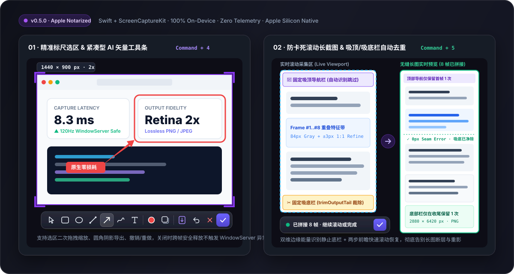

<p align="center">
  
</p>

<h1 align="center">Screen Capture for macOS</h1>

<p align="center">
  <strong>专为 Apple Silicon 打造的原生、高清、100% 本地离线 macOS 截图与滚动长截图工具。</strong><br>
  纯正 Swift + AppKit + ScreenCaptureKit 构建 — 零广告、零会员内购墙、零云端上传、Apple 官方公证免拦截。
</p>

<p align="center">
  <a href="https://github.com/nasadunadu/screen-capture-macos/releases/latest"></a>
  <a href="https://github.com/nasadunadu/screen-capture-macos/releases/latest"></a>
  <a href="https://github.com/nasadunadu/screen-capture-macos/actions/workflows/ci.yml"></a>
  
  
  <a href="LICENSE"></a>
</p>

<p align="center">
  <a href="https://github.com/nasadunadu/screen-capture-macos/releases/latest/download/ScreenCapture-0.5.0-macos-arm64.dmg"><strong>⬇️ 立即下载 DMG 安装包 (v0.5.0 · Apple Silicon)</strong></a>
  &nbsp;·&nbsp;
  <a href="#安装方式"><strong>🍺 Homebrew 一键安装</strong></a>
  &nbsp;·&nbsp;
  <a href="README.md"><strong>English README</strong></a>
  &nbsp;·&nbsp;
  <a href="docs/PRIVACY.md">隐私声明</a>
  &nbsp;·&nbsp;
  <a href="CHANGELOG.md">更新日志</a>
</p>

<p align="center">
  
</p>

> 💡 **如果这款纯粹、无套路的开源截图工具帮到了你，请点击右上角 ⭐ Star 支持项目，让更多饱受付费墙与长截图卡死困扰的 Mac 用户看到它！**

---

## 为什么做 Screen Capture？

Mac 上的第三方截图软件大多走上了同一个怪圈：早期靠免费积累口碑，随后塞满会员付费墙、云账号登录与花哨臃肿的附加功能；而最核心的**“滚动长截图”**遇到带吸顶导航栏或底部悬浮输入框的网页时，依然频繁卡死或拼出多层重复底栏。

**Screen Capture** 只专注把每天最高频的两件事做到极致：
1. **毫秒级 Retina 区域截图与就地标注**（`Command-4`）— `#8839EF` 紫色四角标尺微调、前粗后细精修箭头、紧凑型 AI 矢量毛玻璃工具条，回车即复制/保存无损 PNG。
2. **不卡死、不重影的滚动长截图**（`Command-5`）— 左栏实时滚动、右栏无缝预览；内置**固定吸顶/吸底栏自动识别与增量裁切（`trimOutputTail`）** + **`1:1` 原生像素级接缝精修**。

### 与主流 Mac 截图工具横向对比

| 核心维度 | **Screen Capture (`v0.5.0`)** | macOS 系统自带 (`Cmd+Shift+4`) | 免费增值工具 (`iShot / Xnip`) | 商业付费工具 (`CleanShot X / Shottr`) |
| :--- | :--- | :--- | :--- | :--- |
| **费用与开源协议** | **100% 免费开源 (`Apache-2.0`)** | 免费（系统内置） | 闭源内购 / 会员弹窗 / 长图水印 | 付费买断或订阅（\$12–\$29+）/ 闭源 |
| **滚动长截图能力** | **原生支持 · 吸顶/吸底自动去重 + `1:1` 像素精修** | ❌ 不支持 | ⚠️ 吸底栏易重复残留 / 滚屏中段易卡死 | ✅ 支持 |
| **标注工具条审美** | **紧凑型 `31×31pt` AI 矢量毛玻璃胶囊** | 需先点缩略图进独立窗口，链路慢 | 传统宽大复古图标栏 | 现代悬浮工具栏 |
| **macOS 26/27 `WindowServer` 稳定性** | **进程级 `SCContentFilter` + 跨帧安全析构** | 系统原生 | 旧版按窗口过滤易触发 120Hz 图层崩溃黑屏 | 视版本而定 |
| **隐私与联网边界** | **零网络权限 · 100% 本机内存处理** | 本机处理 | 常含统计 SDK 或云端账户体系 | 含云端上传服务 |
| **Apple 官方公证** | **Developer ID 签名 + Apple 公证盖章** | 系统内置 | App Store / 官网分发 | 官网分发 |

---

## 安装方式

### 方式一：Homebrew Cask 一键安装（推荐开发者与极客）

```sh
brew tap nasadunadu/tap https://github.com/nasadunadu/screen-capture-macos.git
brew install --cask screencapture
```

### 方式二：直接下载已公证 DMG 安装包

1. 点击下载 **[ScreenCapture-0.5.0-macos-arm64.dmg](https://github.com/nasadunadu/screen-capture-macos/releases/latest/download/ScreenCapture-0.5.0-macos-arm64.dmg)**（也可在 [GitHub Releases](https://github.com/nasadunadu/screen-capture-macos/releases/latest) 下载备用 `.zip`）。
2. 双击打开 DMG，将 **ScreenCapture** 拖入 **Applications（应用程序）** 文件夹。
3. 直接双击启动——安装包已通过 Apple 官方 Developer ID 签名与公证（Notarized），macOS Gatekeeper 直接放行，无需任何终端绕过命令。

---

## `v0.5.0` 四大工程级升级亮点

- **系统级稳定性加固（根治 macOS 26/27 `WindowServer` 闪退黑屏隐患）**：
  将 `ScreenCaptureKit` 窗口排除策略从逐窗口数组 `excludingWindows` 升级为进程级 `excludingApplications: [ownApplication]`，并引入 `EditorPanel.retire` 跨 120Hz 渲染周期安全退役机制，彻底阻断窗口销毁瞬间触发的 `CARenderUpdateValidateRestrictedLayerHosts` 异常。
- **滚动长截图防卡死与吸底去重引擎**：
  - 解耦固定顶/底栏遮罩搜索对普通匹配得分的前置门限，解决长网页滚动中段“卡死不动”问题；
  - 融合水平与垂直双维梯度能量识别静止底栏，滚动中途一旦检出固定底栏即通过 `trimOutputTail` 从已拼接尾部精确裁除，彻底消除重复底栏条带；
  - 新增 `1:1` 原生像素级垂直微调（`±3px`）与快速滚动两步前瞻（2-step lookahead）。
- **紧凑型 AI 时代精细矢量工具条**：
  基于 SwiftUI `Canvas` 原生绘制 `17×17pt` 精细矢量图标，`31×31pt` 紧凑按钮热区、`1.5pt` 组内间距、`1px` 极细渐变分隔线与靛蓝渐变主确认键。
- **纯粹本地优先架构**：无 WebView、无账号体系、无遥测统计、无任何第三方运行时依赖。

<p align="center">
  
</p>
<p align="center"><em>原生 SwiftUI 设置面板：支持点击录制全局快捷键、圆角阴影参数调节与屏幕录制权限自检恢复。</em></p>

---

## 默认快捷键

| 功能操作 | 默认全局快捷键 | 是否支持自定义 |
| :--- | :--- | :--- |
| **区域截图与就地标注** | `Command-4` | ✅ 支持（**设置 → 截图**） |
| **滚动长截图** | `Command-5` | ✅ 支持（**设置 → 截图**） |
| **取消当前截图 / 导出** | `Escape` | 全局内置安全取消键 |

---

## 系统与硬件要求

- **硬件架构**：**Apple Silicon（M1 / M2 / M3 / M4 / M5 系列芯片）Mac**。*(Intel Mac 用户请使用历史通用版本 [v0.4.14](https://github.com/nasadunadu/screen-capture-macos/releases/tag/v0.4.14))*。
- **操作系统**：**macOS 14.0 (Sonoma) 及以上**，完整兼容 macOS 14–26 与 macOS 27。
- **系统权限**：首次发起截图时需授予 macOS“屏幕与系统音频录制”权限（本应用仅捕获静态画面，绝不录制音频或视频）。

---

## 从源码构建与验证

使用 Xcode 27+ 打开 `ScreenCapture.xcodeproj` 按 `Command-R` 即可运行；或使用命令行免签名构建：

```sh
DEVELOPER_DIR=/Applications/Xcode.app/Contents/Developer xcodebuild \
  -project ScreenCapture.xcodeproj \
  -scheme ScreenCapture \
  -destination 'platform=macOS' \
  CODE_SIGNING_ALLOWED=NO build
```

执行完整本地质量门禁（配置文件校验、86 项确定性单元测试、Xcode 静态分析、`arm64` Release 构建与 DMG/ZIP 打包冒烟测试）：

```sh
./scripts/ci.sh
```

## 参与贡献与开源许可

提交 PR 前请阅读 [CONTRIBUTING.md](CONTRIBUTING.md)，安全或隐私边界问题请按 [SECURITY.md](SECURITY.md) 私下反馈。本项目采用 [Apache License 2.0](LICENSE) 开源许可。
